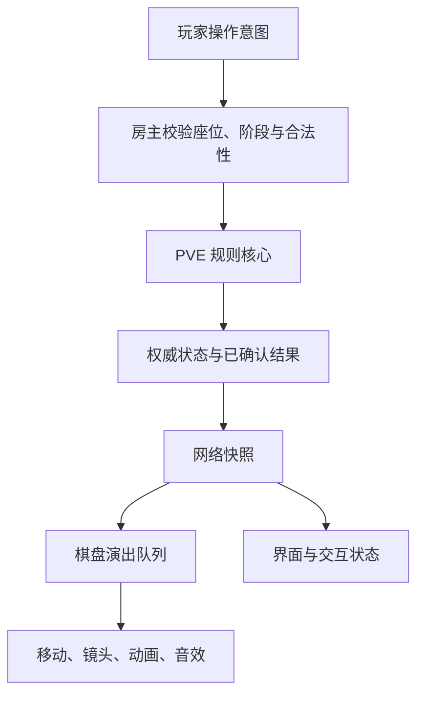

# 技术结构

## 三层分工

完整工程没有把客户端动画当作规则的来源。规则计算、网络同步和视觉呈现分别承担不同职责。

### 规则核心

`PveGameFlow` 及相关纯 C# 类型负责阶段、角色状态、移动选择、卡牌、怪物与任务。规则层尽量不依赖 Unity 的场景对象，便于单独验证边界条件。

### 联机适配

`NetworkPrototypeSession` 接收玩家意图、验证请求并发布状态。网络传输规则状态和已确认路径，而不是让每个客户端各自掷骰或计算一次结果。

UOS 中转接入用于降低联机门槛；房主权威模式不等于独立权威服务器，本项目也没有宣称完成反作弊或生产级云服务验收。

### 棋盘与界面

`NetworkBoardPresenter` 按快照顺序呈现路径、怪物与阶段演出；`NetworkRoomView` 和菜单负责选择、状态信息和局内设置。

服务端最新快照可能已经推进，但画面仍在播放上一个结果。交互许可需要结合当前规则与表现进度，不能让一段尚未结束的演出触发第二次选择。

## 为什么公开演出倍速样例

[独立样例](../examples/PresentationSpeedDemo/README.md) 展示了一个范围较小、容易阅读的问题：

- 支持 1、2、5 三档速度；
- 真人参与者需要一致同意；
- 投票有编号、截止时间和重复提交检查；
- 投票期间人员变化会取消本次提案，而不是静默降低通过门槛；
- 通过后先排期，下一玩家回合才生效；
- 演出时间连续推进，切换时不把过去的时间重新乘一次倍率。

样例只展示状态逻辑，不包含真正的 RPC、账户认证或联机传输。完整游戏仍需在网络边界验证发送者身份，不能把一个调用方传入的布尔值当成安全认证。
